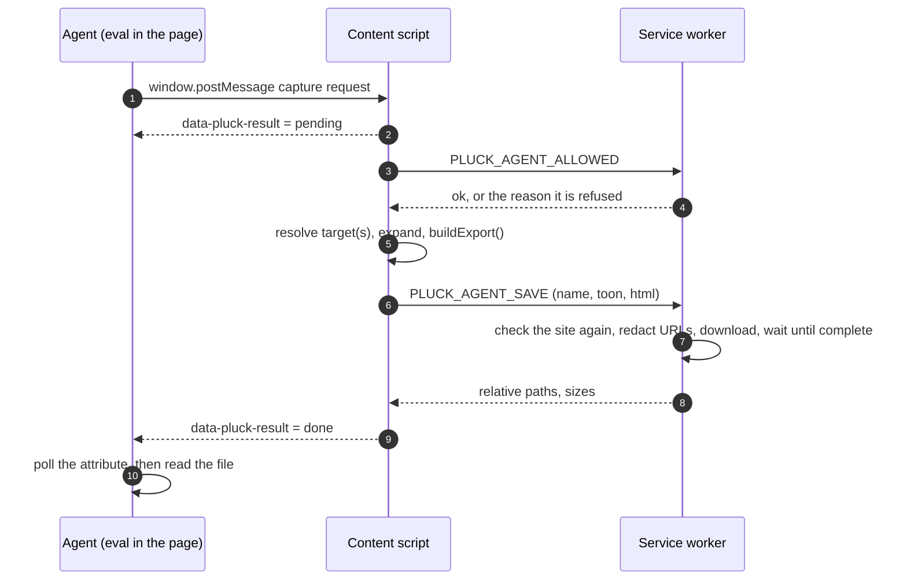

# Driving Pluck from a coding agent

The agent bridge lets an agent that can run JavaScript in a page (Claude in Chrome,
Playwright, Puppeteer, a devtools console) capture components without the dock or the
keyboard. The option table is in the README; this page explains how it works and how to use
it well.

A person picking by hand sees the hover outline before clicking and looks at the result. An
agent sees neither, so the bridge gives it three checks instead: **preview** before capturing,
**expect** on what was captured, and a **fingerprint** to catch a capture that didn't change.

## How the bridge works

### Why messages

An agent driving a browser can run JavaScript in a page, but it can't press Pluck's toolbar
button or shortcuts, and Chrome doesn't let one extension call another. What the agent's
script and Pluck's content script share is the page itself. Chrome runs a content script in
an *isolated world*: it sees the same DOM as the page's scripts, but not their variables. (The
`window.__pluckExtract` helper only works when a test runner injects `contentScript.js` into
the page's own world; an agent in a normal browser can't reach it.) Two things cross the
boundary, one for each direction:

| Direction | Channel | Why this one |
|---|---|---|
| Agent → Pluck | `window.postMessage(...)` | A message event reaches every listener in the tab, content scripts included. |
| Pluck → agent | the `data-pluck-result` attribute on `<html>` | A message is gone once delivered, and an agent's eval call returns before the capture finishes. An attribute stays until the next request, so the agent can come back and read it. |

The content script also posts the result as a `{ __pluckAgent: 'result' }` message, for
callers that can stay and listen.

### Listening

The content script registers one `message` listener on the top frame's `window` when the page
loads, and does nothing until a message arrives. Pages post messages of their own (embedded
players, payment frames, chat widgets), so it ignores everything except messages from the
page's own window (`event.source === window`) carrying `__pluckAgent: 'capture'`.

### The round trip



1. **Request.** The agent clears the old result and posts the request; its eval call returns
   immediately.
2. **Pending.** A second request while one runs is refused. Otherwise the content script
   writes `{"id":…,"status":"pending"}` on `<html>`.
3. **Gate.** The content script asks the worker whether this site is allowed, over
   `chrome.runtime` messaging, which the page can't see or forge.
4. **Resolve and export.** The target is found and, unless `exact`, expanded with the same
   smart expansion a click uses. Your own selection is set aside, the target is selected, and
   the same `buildExport()` the dock uses builds the TOON and HTML (without telling the dock,
   so its loader doesn't spin). Your selection is then put back. A `preview` request stops
   before this step and writes `status: "preview"` instead.
5. **Checks.** `fingerprint` (a hash of the TOON), `sameAsLast` and `missing` are computed
   from the export, not the live page. `missing` lists expected labels absent from the TOON's
   text (not its styles or attribute values), ignoring case and whitespace, the same way the
   preview checks the page text.
6. **Save.** The worker checks the site again from the tab URL Chrome reports, blanks
   sensitive URL parameters (in the query, the fragment and URL-encoded links; add the app's
   own with `redactParams: [...]`), and downloads `pluck/<site>/<name>.toon` and `.html` at
   the same time, with `conflictAction: 'overwrite'`.
7. **Report.** The content script writes the final result on `<html>`; the agent's next poll
   sees it.

### Knowing it finished

`chrome.downloads.download` only *starts* a download. For each file the worker polls
`chrome.downloads.search` every 120 ms and records the file only once Chrome reports it
`complete`; an interrupted download, or one not complete within 15 s, is cancelled. If any
requested file was not saved, the result is `status: "error"` with
`downloads did not complete: <formats>`. So `status: "done"` means every requested file is on
disk.

Accept a result only when its `id` matches the request, `status` is `done`, `missing` is empty
and `sameAsLast` is `false`. Then confirm from the shell
(`ls ~/Downloads/pluck/<site>/<name>.toon`, or let `scripts/agent-import.sh` fail). Paths are
relative to the downloads folder, so the page never learns the account name.

## Using it

### 1. Allow the site

Local development hosts work out of the box. For any other site, open the dock on that tab,
go to **Settings › Agent captures**, and switch the site on. A site that is not allowed gets
no reply at all (so a page cannot detect Pluck): an agent sees the same silence as when Pluck
is not installed. An allowed site matches only its exact origin, port included; the local
hosts match on any port.

### 2. Mark the target

Read the page first (an accessibility snapshot, or a short script listing candidates with
their size and text; `window.__pluckMap` shows the kind of list that helps). Then mark the
element with an attribute; Pluck exports only a fixed set of attributes, so the marker never
appears in the TOON or HTML:

```js
document.querySelectorAll('[data-pluck-target]').forEach((e) => e.removeAttribute('data-pluck-target'));
el.setAttribute('data-pluck-target', '1');
```

### 3. Preview, capture and wait in one call

Every eval round trip costs the agent time, while the extension itself is quick, so do the
whole exchange in one call and stop early only when the preview finds a problem:

```js
const NAME = 'checkout-card', EXPECT = ['Order summary', 'Place order'];
const ask = async (req, maxMs) => {
  const t0 = performance.now();
  document.documentElement.removeAttribute('data-pluck-result');
  window.postMessage(Object.assign({ __pluckAgent: 'capture',
    selector: '[data-pluck-target="1"]', exact: true, expect: { text: EXPECT } }, req), '*');
  for (;;) {
    await new Promise((r) => setTimeout(r, 100));
    const raw = document.documentElement.getAttribute('data-pluck-result');
    const res = raw && JSON.parse(raw);
    if (res && res.id === req.id && res.status !== 'pending') return res;
    if (performance.now() - t0 > maxMs) return { id: req.id, status: 'still-pending' };
  }
};
const pv = await ask({ id: 'p' + Date.now(), preview: true }, 5000);
if (pv.status !== 'preview' || pv.missing.length || pv.summary.hidden) JSON.stringify(pv);
else JSON.stringify(await ask({ id: 'c' + Date.now(), name: NAME }, 30000));
```

The preview's `summary` lists the box, whether it is hidden or partly off screen, its
headings and its controls with labels. The outline stays up about 4 s (`previewMs`), long
enough for a screenshot when the target is in doubt. Several elements: `selectors: [...]`,
and `combine: 'ancestor'` for their common parent.

Errors: `a capture is already running`, `target not found`, `no element matches: …` (with
`missing`), `invalid selector: …`, `downloads did not complete: …`. If Pluck was reloaded
after the page opened, requests fail with an "Extension context invalidated" reason; reload
the page. Send one request at a time and wait for its result: the result attribute holds only
the latest answer, so a request sent while another runs can lose its rejection.

### 4. Move it into the project

```bash
scripts/agent-import.sh checkout-card path/to/captures
# PLUCK_SITE=localhost-3000 …   take it from one site's folder
# PLUCK_REDACT='mysessionkey' … also blank the app's own session parameter
```

The script takes the newest capture of that name, moves it, and prints the TOON's section
outline with line numbers. Read `## Structure` first, then only the styles it uses.

## Tips from real use

- **Re-define helpers after navigation.** Page-swapping apps replace `window`, so a helper
  defined in one eval is gone after the next navigation.
- **Visible text:** many enterprise UIs render non-breaking spaces; match with `/A\s+B/`.
  `expect` already normalizes whitespace and case.
- **Never "nudge" a stalled capture with a key press** — it lands in whatever input has focus.
- **Pick the container deliberately.** A `form` can be too small or the whole page. Preview it
  and check the headings and controls it lists.
- **Menus rendered elsewhere.** Many apps attach an open dropdown to the end of `<body>`,
  outside the field's container; capture the open menu as its own target.
- **Clean up.** Remove your marker and the `data-pluck-result` attribute when done.
